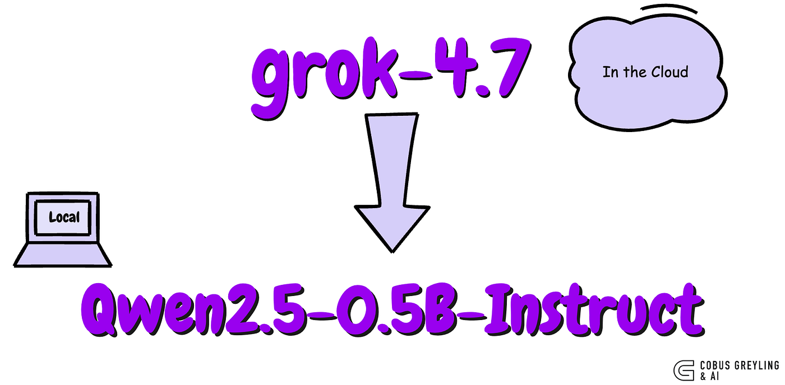
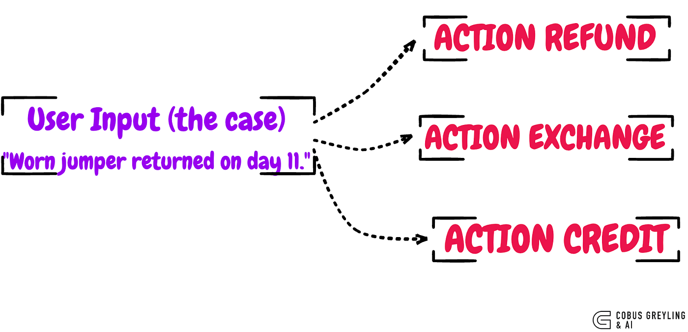

# Sequence-level Distillation

Fine-tuning a smaller model to be a decision engine via distillation.

Published on Medium: [Sequence-level Distillation](https://cobusgreyling.medium.com/sequence-level-distillation-02351f01a1ef).

With the advent of [Jev](https://cobusgreyling.medium.com/jev-by-typesafe-ai-4846aaca3186) there has been focus on decision systems, where the model does not return text or content or the like, but rather a decision. This made me think to fine-tune a model on the input of a prompt and the completion being a word which is a decision.

It is also a type of classification where user input is classified and based on this classification a decision is made.

The working prototype I built was to have Grok model as the larger teacher model and the Qwen model as the student model.

The idea is to train the smaller model on the return policies. And based on the user input, one of three actions are returned, *refund*, *exchange* or **credit**.

Grok did not know the return rules and policies. The codebook was pasted into its Grok prompt for each case, and that prompt was the only place the rules existed.

But obviously in a production deployment the rules have to come from somewhere the teacher can read while it writes the training lines.

Typical sources are a policy document, a table of past clerk decisions, or a rules service the teacher calls. The teacher applies that source to thousands of real cases and saves the answers. The small model is then trained on those answers, and after that it can answer without looking the policy up on every request.

The reason for doing this is the saving is at inference time. The policy lookup, the long prompt, and the large model stay in the offline job that builds the training file.

The deployed model is the small one, carrying the decision in its weights. If the policy changes, the teacher has to be run again and the small model trained again, because the new rule is not in its prompt.

It is called sequence-level distillation because the training target is an ordered string of tokens, and that string is called a sequence.

That is the “sequence” in sequence-level distillation. The level is the reply, token after token, rather than a probability attached to one word.

Below is a table with the training data:

| # | User (the case) | Completion (what the model is scored on) |
|---|---|---|
| tr01 | Unworn sweater returned on day 9. | ACTION REFUND |
| tr02 | Unworn pullover, tags on, back after 4 days. | ACTION REFUND |
| tr03 | Worn jumper returned on day 11. | ACTION EXCHANGE |
| tr04 | Knit top with pilling, returned on day 6. | ACTION EXCHANGE |
| tr05 | Unworn knit scarf returned on day 20. | ACTION CREDIT |
| tr06 | Sweater back after 30 days, never worn. | ACTION CREDIT |
| tr07 | Unworn coat returned on day 12. | ACTION REFUND |
| tr08 | Jacket, tags on, day 28. | ACTION REFUND |
| tr09 | Worn parka returned on day 15. | ACTION ESCALATE |
| tr10 | Jacket with a scuffed cuff, day 22. | ACTION ESCALATE |
| tr11 | Unworn coat returned on day 45. | ACTION CREDIT |
| tr12 | Parka back after 60 days, never worn. | ACTION CREDIT |
| tr13 | No receipt for an unworn shirt on day 3. | ACTION ESCALATE |
| tr14 | Sale-price beanie, unworn, returned yesterday. | ACTION CREDIT |

The small model missed because each rule was tied to only a few sentences. “Never worn” appeared only on late returns, so the phrase itself became the signal for CREDIT. A resilient model has to see every rule in many wordings, including the phrases that currently point the wrong way.

> A production system needs a harness around its models.

The harness manages tools, memory and context…and it routes each request to the model that should handle it.

That routing belongs in any production setup. One request goes to a frontier model. Another goes to a small model trained for a single task.

Frontier models remain the right choice for deep research, software development, and extended planning. For a repeated, narrow decision, a fine-tuned open model built for that task is the one to deploy.

### Step 1. Write the rules

The demo use case here is a retail scenario and in specific return policy. The product return are short on purpose, so a person can check every answer by hand.

The first rule that fits is the answer. A sale item is store credit even when it would also have matched a knitwear rule.

1. No receipt, or the customer lost the receipt: **ESCALATE**.
2. Sale, sale-price, or clearance: **CREDIT**.
3. Knitwear (sweater, jumper, cardigan, pullover, knit top, knit scarf). Within 14 days and unworn: **REFUND**. Within 14 days and worn: **EXCHANGE**. Day 15 or later: **CREDIT**.
4. Outerwear (coat, jacket, parka). Within 30 days and unworn: **REFUND**. Within 30 days and worn: **ESCALATE**. Day 31 or later: **CREDIT**.

Unworn means tags on, never worn, or still unworn. Worn means wear, pilling, scuffs, or a tear. “Yesterday” means day 1. “After 50 days” means day 50.

### Step 2. Write twenty cases

Each case is one sentence a clerk might hear. Fourteen are for training. Six are held out. The holdout uses the same rules and different wording, so a model cannot pass by memorising a sentence.

A training case: “Worn jumper returned on day 11.” The rule says knitwear, within 14 days, worn, so the answer is EXCHANGE.

A holdout case: “A jumper with signs of wear, returned on day 8.” Same rule, new sentence. The answer is still EXCHANGE.

### Step 3. Ask Grok, and keep the rules to itself

Grok 4.7 is the teacher. For each case it receives two things: the codebook, and the sentence. It is told to reply with one line and nothing else:

ACTION REFUND or ACTION EXCHANGE or ACTION CREDIT or ACTION ESCALATE

Grok 4.7 always does a little reasoning before it answers. The call sets that effort to low, which is enough for a four-way label and keeps each reply to a few seconds. All twenty replies came back as a single ACTION line. All twenty matched the codebook.

Those replies are the training data. The student never receives the codebook. It receives a short instruction (“you are the Northline returns clerk, reply with one ACTION line”) and the customer’s sentence. The target it must learn is Grok’s line.

### Step 4. The fourteen lines the student trained on

These are Grok’s exact replies. Nothing was added after them. The six holdout replies from Grok were saved in the same file and left out of training.

### Step 5. Train the small model

The student is Qwen2.5-0.5B-Instruct. The base weights stay frozen. Training adds a LoRA adapter: a few small matrices that learn this desk, and nothing else.

The loss looks only at the answer. The question is shown, so the model knows which case it is on and the model is scored only for writing the ACTION line. That is called completion-only loss.

There were 14 training lines, repeated for 8 passes, which is 112 steps. On my Mac that took 22 seconds. The loss ended at 0.20 and the student then matched Grok on every training line.

Before any training, the same small model was asked the same questions. It answered ACTION REFUND every time. REFUND is the first action named in its instruction, and the model had no reason yet to pick another one. The format was already there. The decision was not.

### Step 6. Score the holdout

The holdout is the honest test. Six new sentences. The student had not trained on them. The stock model is the same Qwen, before the adapter.

| | Train (14 lines) | Holdout (6 lines) |
|---|---:|---:|
| Stock Qwen 0.5B | 4 / 14 | 2 / 6 |
| After distillation | 14 / 14 | 3 / 6 |

The stock model’s 4 and 2 are the cases whose true answer happens to be REFUND. It did not choose. It always said REFUND. After training, the student was perfect on the sentences it had studied, and right on 3 of the 6 new ones.

| Holdout case | Codebook | Stock | Student |
|---|---|---|---|
| Customer brings back an unworn sweater on day 7. | REFUND | REFUND | CREDIT |
| A jumper with signs of wear, returned on day 8. | EXCHANGE | REFUND | EXCHANGE |
| Wool coat, never worn, returned on day 19. | REFUND | REFUND | CREDIT |
| Parka with a torn pocket, returned on day 27. | ESCALATE | REFUND | EXCHANGE |
| Unworn jacket returned after 50 days. | CREDIT | REFUND | CREDIT |
| Clearance scarf, still unworn, returned yesterday. | CREDIT | REFUND | CREDIT |

The student copies the teacher on sentences it has seen. On a new sentence it grabs the nearest familiar cue and more varied examples would be the next step. More training steps on these same fourteen would only memorise them harder.

**Here is the repo:** [cobusgreyling/sequence-distillation](https://github.com/cobusgreyling/sequence-distillation).
