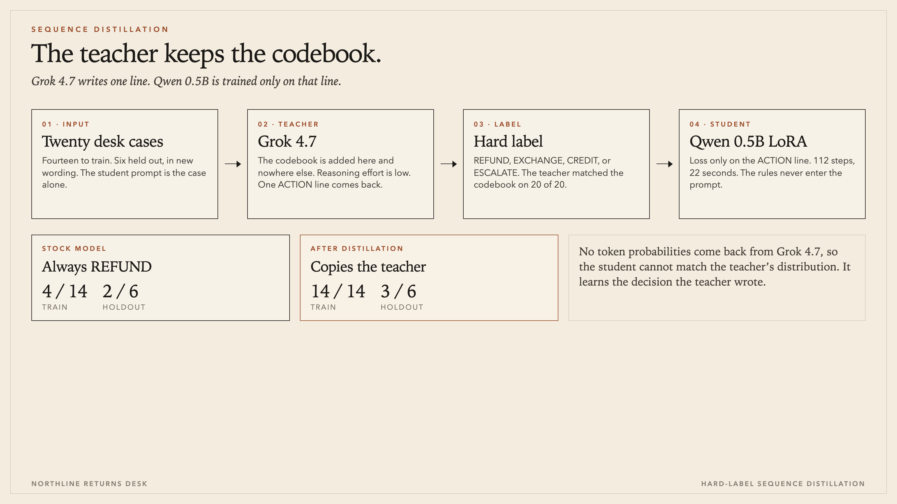

# A returns desk, distilled

Grok 4.7 reads a private codebook. Qwen2.5-0.5B never does. The small model is trained only on the one line Grok wrote.

This repo is that run, with the labels, the scores, and the adapter. You can retrain the student with no API key. The twenty teacher replies are already in [`data/teacher.jsonl`](data/teacher.jsonl).

| | Train, 14 lines | Holdout, 6 new wordings |
|---|---:|---:|
| Stock Qwen 0.5B | 4 / 14 | 2 / 6 |
| After distillation | 14 / 14 | 3 / 6 |

The stock model answered `ACTION REFUND` every time. Its hits are the cases whose true answer happens to be refund. Training took 112 LoRA steps and 22 seconds. Final loss was 0.20.

## Run it

Python 3.10 or newer. A Mac with MPS is enough. The base weights are [`Qwen/Qwen2.5-0.5B-Instruct`](https://huggingface.co/Qwen/Qwen2.5-0.5B-Instruct), about 1 GB the first time.

```bash
pip install -r requirements.txt
python distill.py train
```

`train` scores the untouched 0.5B model, fits the LoRA on the 14 lines, then scores the adapter. Holdout lines are never in the loss.

To ask Grok again, put a key in the environment or in a gitignored `.env` (see [`.env.example`](.env.example)). The script reads `XAI_API_KEY` and does not print it.

```bash
export XAI_API_KEY=...
python distill.py collect --refresh
python distill.py train
```

`collect` with no `--refresh` keeps the file that is already here. `all` is collect-then-train, and it is the default.

## What the student was trained on

Each target is Grok’s whole reply. Nothing was added. The student prompt is a one-line clerk instruction plus the case. The codebook is not in that prompt.

| Case | Grok’s reply |
|---|---|
| Unworn sweater returned on day 9. | `ACTION REFUND` |
| Unworn pullover, tags on, back after 4 days. | `ACTION REFUND` |
| Worn jumper returned on day 11. | `ACTION EXCHANGE` |
| Knit top with pilling, returned on day 6. | `ACTION EXCHANGE` |
| Unworn knit scarf returned on day 20. | `ACTION CREDIT` |
| Sweater back after 30 days, never worn. | `ACTION CREDIT` |
| Unworn coat returned on day 12. | `ACTION REFUND` |
| Jacket, tags on, day 28. | `ACTION REFUND` |
| Worn parka returned on day 15. | `ACTION ESCALATE` |
| Jacket with a scuffed cuff, day 22. | `ACTION ESCALATE` |
| Unworn coat returned on day 45. | `ACTION CREDIT` |
| Parka back after 60 days, never worn. | `ACTION CREDIT` |
| No receipt for an unworn shirt on day 3. | `ACTION ESCALATE` |
| Sale-price beanie, unworn, returned yesterday. | `ACTION CREDIT` |

Grok also labelled the six holdout sentences. Those rows are in the same file, with `"split": "holdout"`, and the trainer skips them.

## The codebook the student never saw

Northline is a fictional shop. The first rule that fits is the answer, so a sale item is credit even when it is also unworn knitwear.

1. No receipt, or the customer lost the receipt → `ESCALATE`
2. Sale, sale-price, or clearance → `CREDIT`
3. Knitwear (sweater, jumper, cardigan, pullover, knit top, knit scarf). Within 14 days and unworn → `REFUND`. Within 14 days and worn → `EXCHANGE`. Day 15 or later → `CREDIT`.
4. Outerwear (coat, jacket, parka). Within 30 days and unworn → `REFUND`. Within 30 days and worn → `ESCALATE`. Day 31 or later → `CREDIT`.

Unworn means tags on, never worn, or still unworn. Worn means wear, pilling, scuffs, or a tear. “Yesterday” is day 1.

Grok 4.7, at low reasoning effort, matched this codebook on all 20 cases. Each call came back as a single `ACTION` line.

## Where the small model slips

The holdout uses the same rules and different wording. Three of the six went to the wrong action. The pattern is a familiar phrase winning over the day count.

| Holdout case | Codebook | Stock | Student |
|---|---|---|---|
| Customer brings back an unworn sweater on day 7. | REFUND | REFUND | CREDIT |
| A jumper with signs of wear, returned on day 8. | EXCHANGE | REFUND | EXCHANGE |
| Wool coat, never worn, returned on day 19. | REFUND | REFUND | CREDIT |
| Parka with a torn pocket, returned on day 27. | ESCALATE | REFUND | EXCHANGE |
| Unworn jacket returned after 50 days. | CREDIT | REFUND | CREDIT |
| Clearance scarf, still unworn, returned yesterday. | CREDIT | REFUND | CREDIT |

The sweater on day 7 became `CREDIT`. Training had an unworn sweater on day 9 as `REFUND`, and a sweater after 30 days as `CREDIT`. “Brings back” did not keep the early refund.

The coat that says “never worn” also became `CREDIT`. In the training lines that phrase belongs to the late returns. A coat on day 19 is still inside the refund window.

The torn parka became `EXCHANGE`. A tear means worn, and worn knitwear in training is `EXCHANGE`. Worn outerwear is supposed to be `ESCALATE`.

Fourteen examples are enough to copy the teacher on the sentences it has seen. On a new sentence the student grabs the nearest cue. More varied lines would be the next experiment. More steps on these same fourteen would only memorise them harder.

## The path



The codebook is added at Grok and stops there. The loss is only on the ACTION line.

## Why this is called sequence-level

The research name is sequence-level knowledge distillation. Yoon Kim and Alexander Rush introduced it for translation in 2016: train the student with ordinary cross-entropy on full sentences from the teacher ([arXiv:1606.07947](https://arxiv.org/abs/1606.07947)).

They also describe a word-level version, where the student matches the teacher’s probability at every token. This run is the sentence version. Grok 4.7 does not return those probabilities, so the student learns the sentence Grok wrote. That sentence is a hard label: one choice, no distribution.

The adapter is LoRA, rank 8, alpha 16, on the attention and MLP projections. The base weights stay frozen. Completion-only loss means the question is visible and only the answer is scored.

## Use the adapter without retraining

[`outputs/lora`](outputs/lora) is the adapter from this run.

```python
from peft import PeftModel
from transformers import AutoModelForCausalLM, AutoTokenizer

base = "Qwen/Qwen2.5-0.5B-Instruct"
model = PeftModel.from_pretrained(
    AutoModelForCausalLM.from_pretrained(base),
    "outputs/lora",
)
tokenizer = AutoTokenizer.from_pretrained(base)
```

Ask it the same way the trainer does. System text: “You are the Northline returns clerk. Reply with one line and nothing else: ACTION REFUND, ACTION EXCHANGE, ACTION CREDIT, or ACTION ESCALATE.” User text: the case.

## What is in the repo

| Path | What it is |
|---|---|
| [`distill.py`](distill.py) | Ask Grok, train the LoRA, print both score tables |
| [`data/teacher.jsonl`](data/teacher.jsonl) | 20 Grok replies. 14 train, 6 holdout. `gold` is the codebook, `teacher` is Grok |
| [`outputs/results.json`](outputs/results.json) | Stock and student answers for every case |
| [`outputs/lora`](outputs/lora) | The adapter from the 112-step run |
| [`assets/header.png`](assets/header.png) | The figure at the top |
| [`assets/flow.png`](assets/flow.png) | The figure above |
| [`requirements.txt`](requirements.txt) | torch, transformers, peft, trl, datasets, openai |

Each JSONL row has `id`, `split`, `text`, `gold`, `teacher`, `teacher_raw`, `prompt`, and `completion`. The trainer uses `prompt` and `completion` on rows whose split is `train`.

## What this is not

It is one desk, fourteen lines long. It is not a general copy of Grok, and it is not token-level distillation. The interesting failure is on purpose: a half-billion-parameter model will repeat a phrase it has seen before it will apply a day-count it has only met inside other sentences.
